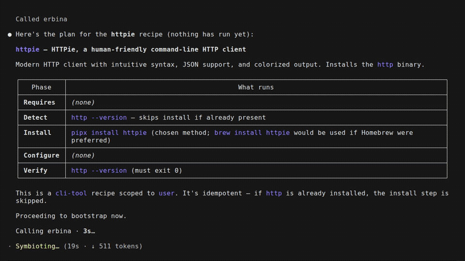

# erbina

> A Claude-Code-only MCP server that bootstraps your dev environment from one
> prompt — install, wire, and **verify** CLI tools and other MCP servers from
> curated recipes, and see where every MCP server lives across your scopes.

[](https://github.com/noahhyden/erbina/actions/workflows/ci.yml)
[](https://github.com/noahhyden/erbina/releases)
[](LICENSE)
[](https://modelcontextprotocol.io)
[](https://code.claude.com)



Named after the Lusitanian goddess of boundaries and crossings — erbina is the
threshold a tool crosses to become part of your environment. Sibling to
[ataegina](https://github.com/noahhyden/ataegina-cli) (goddess of rebirth), which
is also erbina's proof-of-concept recipe #1.

> **The recipe contract is the core idea.** One server, eleven tools, and a curated
> set of **500+ recipes** spanning `cli-tool`s, scope-wiring `mcp-server`s, and
> `profile`s that bundle them (see the [Finding recipes](#finding-recipes)). Each is
> one YAML file held to a conformance bar — schema + linter policy + a 100%-covered
> offline suite, plus a weekly job that actually installs it on macOS, Linux, and
> Windows — and adding one is the point.

## Why this exists

Setting up a coding-agent environment is death by a thousand cuts: you install a
CLI, hand-edit a config, add an MCP server — then find out it's in the wrong
*scope* and isn't showing up. Claude Code spreads MCP config across **up to four
files in two apps**, with no single place that knows what's installed where
([anthropics/claude-code#27458](https://github.com/anthropics/claude-code/issues/27458),
[#8288](https://github.com/anthropics/claude-code/issues/8288),
[#5963](https://github.com/anthropics/claude-code/issues/5963)).

erbina makes setup a thing an **agent does for you, and proves worked**:

- **It's an MCP server, so an agent must drive it.** There is no human entry
  point — run it by hand and you get nothing. Nobody mistakes it for a manual
  installer that "should just work."
- **Recipes, not one-shot installs.** Each entry is a contract:
  **detect → install → configure → verify**. Idempotent by construction — it
  detects what's already there and skips it, and success means the tool *runs*,
  not that a line was written to a file. Recipes also **compose** (`requires:`
  prerequisites, `profile`s that bundle a whole set) and cover the **full
  lifecycle**: `update` → re-verify, `uninstall`, and a `doctor`
  health-check over everything erbina installed.
- **Scope-aware.** It knows about Claude Code's `local` / `project` / `user`
  scopes, wires MCP-server recipes into the right one, and audits all three so
  you finally have one place that answers "what's installed, and where?"
- **Proven, not just written.** On top of the offline suite, a weekly (and
  on-demand) CI job bootstraps recipes *for real* against live package managers on
  **macOS, Linux, and Windows** — so a renamed brew formula, a dead URL, or a bad
  winget id is caught, not shipped.

## Install

erbina is a single Python file run by [`uv`](https://docs.astral.sh/uv/) (it
declares its own dependencies inline — no venv to manage).

```bash
git clone https://github.com/noahhyden/erbina
# register it with Claude Code (use --scope user to make it available everywhere)
claude mcp add erbina --scope user -- uv run --script /absolute/path/to/erbina/server.py
```

Then, in Claude Code, just ask: *"use erbina to set up ataegina"* — the agent
inspects the recipe, shows you exactly what it will run, then bootstraps and
verifies it.

Requirements: `uv` and Claude Code, on macOS, Linux, or Windows. Plus whatever a
recipe's install method needs — typically `brew` on macOS, `winget` on Windows, or
a language toolchain (`cargo` / `go` / `pipx`) or `curl` fallback elsewhere. Every
method is guarded, so only one that actually exists on your machine ever runs.

### Headless / CI usage

In an interactive session `claude mcp add …` (above) handles the trust prompt for
you. A non-interactive `claude -p` run has no prompt to answer, so you load the
server with `--mcp-config` and **pre-approve** erbina's tools with `--allowedTools`
(their names are `mcp__erbina__<tool>`). Write an MCP config once:

```json
// erbina.mcp.json
{ "mcpServers": { "erbina": {
  "command": "uv",
  "args": ["run", "--script", "/absolute/path/to/erbina/server.py"]
} } }
```

```bash
# read-only: discover + inspect (nothing executes)
claude -p "use erbina to list recipes, then inspect ripgrep" \
  --mcp-config erbina.mcp.json --strict-mcp-config \
  --allowedTools mcp__erbina__list_recipes mcp__erbina__inspect_recipe

# install for real (add mcp__erbina__bootstrap to the allowlist)
claude -p "use erbina to bootstrap the modern-unix profile" \
  --mcp-config erbina.mcp.json --strict-mcp-config \
  --allowedTools mcp__erbina__bootstrap
```

`--strict-mcp-config` makes the run use *only* the servers in that file, so it
never picks up your global config. Omit `--allowedTools` and a headless call
can't call any tool — that's the one thing new CI users trip on.

## Tools

| Tool | What it does |
|---|---|
| `list_recipes` | List the curated recipes erbina can bootstrap — each with a `category` and search `tags` so you can tell at a glance what it's for. |
| `search_recipes` | Find a recipe by keyword and/or filter (`category`, `kind`) instead of scanning the whole list — ranked by relevance. E.g. "a JSON tool" or `category="kubernetes"`. |
| `list_categories` | A domain map of the registry — every category with a recipe, how many, and example tools. See what erbina **covers** at a glance, then drill in with `search_recipes(category=…)`. |
| `inspect_recipe` | Show **exactly** what bootstrapping a recipe would run — the consent surface. Nothing executes. |
| `bootstrap` | Run a recipe: detect → install → configure → verify, idempotently. `dry_run=true` returns the full plan without executing. |
| `check_updates` | Read-only report of whether installed tools have newer versions available, for recipes that declare a `version:` block. Pinned tools are flagged and excluded. |
| `update` | Upgrade an installed tool, then **re-run `verify`** as a safety net — on failure it rolls back (if the recipe supports it) or marks the tool broken. `dry_run=true` shows the command first. |
| `pin` | Pin (or unpin) a tool so automatic updates skip it. `update` refuses a pinned tool unless `force=true`. |
| `audit_scopes` | Read-only report of which MCP servers are configured in `local` / `project` / `user` scope, where each lives, and any name shadowed across scopes. |
| `find_dead_mcps` | Health-check every configured MCP server and flag the ones that fail to connect — stale/dead servers, annotated with the scope to remove them from. Read-only. |
| `remove_mcp` | Remove an MCP server by name (e.g. a dead one), auto-resolving its scope. `dry_run=true` shows the `claude mcp remove` command without running it. |
| `doctor` | Health-check the CLI tools erbina has installed (its state manifest): re-run each one's `detect` + `verify` and report healthy / missing / broken. Read-only; the CLI-tool counterpart to `find_dead_mcps`. |
| `uninstall` | Reverse a cli-tool install via the recipe's `uninstall:` block, confirm it's gone (re-run `detect`), and forget it in the state manifest. `dry_run=true` shows the command first. For MCP servers use `remove_mcp`. |

The server's instructions tell the agent to **always inspect (or dry-run) and
show you the commands before executing** — erbina shells out to package managers
with real privileges (it runs as a sibling process, not under Claude Code's Bash
sandbox), so consent before execution is the safety model.

## How a recipe works

A recipe is four phases an agent executes. The proof-of-concept entry,
[`recipes/ataegina.yaml`](recipes/ataegina.yaml):

```yaml
detect:   { command: "ataegina --version", expect_exit: 0 }   # skip install if present
install:                                                       # first guard to pass wins
  methods:
    - { id: homebrew, when: "command -v brew", run: "brew install noahhyden/tap/ataegina" }
    - { id: curl,     when: "command -v curl", run: "curl -fsSL .../install.sh | sh" }
configure: { steps: [ { run: "ataegina init --yes", needs_project_dir: true, optional: true } ] }
verify:   [ { command: "ataegina --version", expect_exit: 0 } ]
```

A `kind: mcp-server` recipe instead wires a server into a chosen scope — its
configure step is `claude mcp add <name> --scope ${scope} -- …`, where `${scope}`
is substituted from the `scope` you pass to `bootstrap`. See
[`recipes/fetch.yaml`](recipes/fetch.yaml). A `kind: profile` recipe installs
nothing itself — it just `requires:` a curated set, so one prompt bootstraps the
whole bundle.

Recipes can also declare optional blocks: `requires:` (prerequisites bootstrapped
first), `version:` + `update:` (auto-updates, with `latest:` as a
command or the `{ github: owner/repo }` shorthand), and `uninstall:` (teardown).
Because each install method's `when:` guard runs in the host shell, methods are
cross-platform — a `winget` method fires only on Windows, `brew`/`cargo`/`curl`
only where they apply. The full schema is in [SCHEMA.md](SCHEMA.md).

> [!WARNING]
> **Windows support is limited and error-prone.** macOS and Linux are the
> first-class targets. Most `winget` package ids were resolved in bulk against the
> winget catalog and are only spot-checked, so some may be wrong, out of date, or
> resolve to a look-alike package — a `winget install` can fail or, worse, install
> the wrong tool. The `when:` guard means a bad winget method fails cleanly rather
> than breaking a POSIX bootstrap, but treat Windows as best-effort: verify what
> got installed. Fixes are welcome.

## Auto-updating tools

A recipe can opt into update checks by declaring a `version:` block (an installed
`current` command and a `latest` source) and, optionally, an `update:`
method. Then:

- **`check_updates`** compares installed vs latest (numeric/pre-release aware, via
  `packaging`) and reports what's out of date — it never claims an update it can't
  parse, skips **pinned** tools, and for a `{ github: … }` source includes a
  release-notes link so you can review before applying.
- **`update`** applies the upgrade and **re-runs `verify`**; if verify fails it
  marks the tool `broken` in the state manifest and returns a recovery plan
  (the recorded previous version plus manual instructions). There is no
  automatic revert.
- erbina records what it manages in a small state manifest (`~/.erbina/state.json`)
  — versions, install method, and pins.

Schema details are in [SCHEMA.md](SCHEMA.md).

### Enabling automatic checks (opt-in)

erbina is an MCP server with **no CLI**, so nothing can call `check_updates` on a
timer directly — the *agent* has to. Both mechanisms below just nudge the agent;
neither installs or updates anything without your confirmation, and neither
touches your live config unless you add it yourself.

**Option A — SessionStart hook (checks each new session).** Point a SessionStart
hook at the bundled script
[`examples/erbina-session-start.sh`](examples/erbina-session-start.sh), which
prints a hook payload whose `additionalContext` asks the agent to run
`check_updates` and surface anything available. Add to `.claude/settings.json`
(or `~/.claude/settings.json` for all projects):

```json
{
  "hooks": {
    "SessionStart": [
      {
        "matcher": "startup|resume",
        "hooks": [
          { "type": "command", "command": "bash /ABSOLUTE/PATH/TO/erbina/examples/erbina-session-start.sh" }
        ]
      }
    ]
  }
}
```

Remove the hook block to turn it off.

**Option B — scheduled routine (checks on a cron).** Create a Claude Code
scheduled routine (`/schedule`) whose prompt is:

> Use erbina's `check_updates` tool to see whether any installed tools have
> updates. If any do, report the `summary` and ask me before applying anything
> with erbina's `update` tool. If nothing is available, do nothing.

Pick a cadence (e.g. weekly).

**What the agent gets.** `check_updates` returns a terse `summary` (e.g. `erbina:
2 tool update(s) available — a, b.`) plus per-tool `checked` details and
`updates_available` (pinned tools excluded). The agent surfaces the summary and,
on your go-ahead, runs `update` per tool, which re-verifies afterwards.

## Finding recipes

520+ recipes live in [`recipes/`](recipes/). Agents discover them with the
`search_recipes`, `list_categories` and `list_recipes` tools; you rarely need to
browse the directory by hand.

## Adding a recipe

Drop a `<id>.yaml` in `recipes/` following [SCHEMA.md](SCHEMA.md). `kind:
cli-tool` installs a binary; `kind: mcp-server` additionally wires it into the
chosen Claude Code scope; `kind: profile` just bundles others via `requires:`.
Keep `detect` cheap and `verify` honest (prove it runs).

## What this is *not*

Not a package manager you run by hand (that's `mcpm` / `brew` / `aqua`), not a
discovery registry (that's Smithery), and not a way to "rebuild my laptop
deterministically" (use Nix / chezmoi / a Brewfile — an LLM-driven setup is the
wrong tool for reproducible provisioning). erbina's niche is the intersection: 
**agent-run, verify-on-install recipes that span CLI tools *and* MCP servers, 
aware of Claude Code's scopes.**

## Safety model

erbina runs as an ordinary sibling process of Claude Code — **not** inside its
Bash sandbox — so a recipe's commands execute with your real privileges. The
safety model is **consent before execution**: `inspect_recipe` and
`bootstrap(dry_run=true)` show you the exact commands first, and the server
instructs the agent to surface that plan before any real run.

A recipe's `install.methods[].run` is a shell command string, so a malicious or
compromised recipe file is equivalent to a malicious shell script, and erbina
does not — and cannot — sandbox it. **Only bootstrap recipes you have read, from
a checkout you trust.**

erbina reads `~/.claude.json` and any project `.mcp.json` to answer "what MCP
servers are installed, and where", and shells out to `claude mcp list`. It sends
**no telemetry** and makes **no network calls of its own** — the only outbound
activity is whatever a recipe's own commands do when you bootstrap it.

Found a vulnerability? Report it privately through
[GitHub Security Advisories](https://github.com/noahhyden/erbina/security/advisories/new),
not a public issue.

## Contributing

The most useful contribution is usually a **new recipe** — one YAML file in
`recipes/`. See [CONTRIBUTING.md](CONTRIBUTING.md) for the ground rules and how
to smoke-test with an in-memory FastMCP client, [SCHEMA.md](SCHEMA.md) for the
recipe contract, and [CHANGELOG.md](CHANGELOG.md) for what's landed.

## License

[Apache License 2.0](LICENSE).

The name **erbina**, the name **Noah Hyden**, and the project's logos are
trademarks and are *not* covered by that licence — see
[TRADEMARKS.md](TRADEMARKS.md) for what's fine without asking, and
[NOTICE](NOTICE). Fork the code freely; just give your fork its own name.

Releases published before the move to Apache 2.0 keep the MIT terms they
shipped under.
